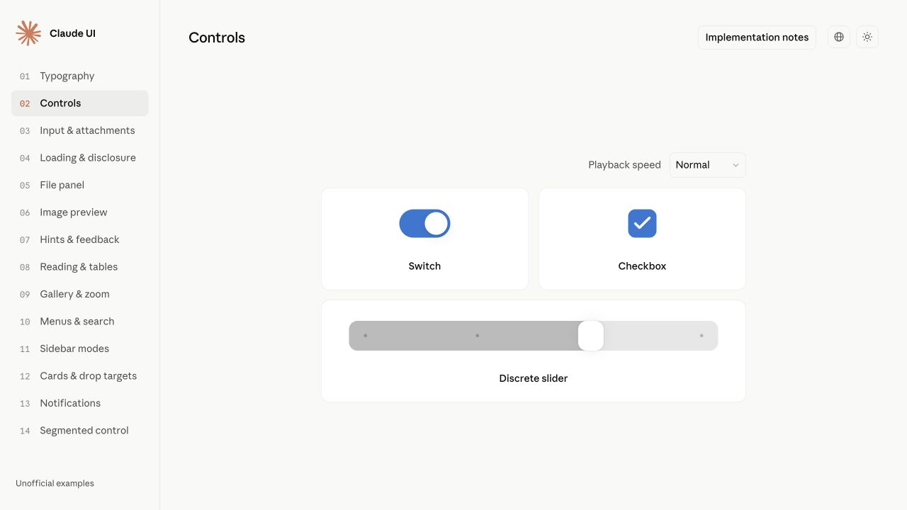

<h1 align="center">Claude UI Skills</h1>

<p align="center">An agent skill for Claude-inspired UI and motion, with scenario guides and runnable frontend examples.</p>

<p align="center">
  <a href="#demo">Demo</a> ·
  <a href="references/components.md">Component guides</a> ·
  <a href="README.zh-CN.md">简体中文</a>
</p>

<p align="center">
  
</p>

## React components

Reusable TSX components styled with Tailwind CSS, with typed props and scoped themes. All 14 demo chapters import the same public components. [Run and import](demo/README.md) · [Migration record](docs/react-migration.md).

## Install

Clone the complete repository into an unused Codex skill directory. The guides reference its bundled TSX and CSS:

```sh
mkdir -p "${CODEX_HOME:-$HOME/.codex}/skills"
git clone https://github.com/wcqqq1214/claude-ui-skills.git \
  "${CODEX_HOME:-$HOME/.codex}/skills/claude-ui-skills"
```

## Usage

```text
Use $claude-ui-skills to adapt this page's sidebar and segmented controls.
```

UI, frontend interactions, typography and motion only. [Scope and coverage](docs/coverage.md).

## Demo

Explore 14 interactive chapters, including segmented controls, panels, search highlighting and four status animations. Supports English, Simplified Chinese and light/dark themes.

See [local preview instructions](demo/README.md#run). Source preview uses Node.js and Vite; the production build is a static site with local assets and no backend or Claude installation.

## License

Project-authored code and documentation: [MIT](LICENSE). Third-party fonts, icons and logos retain their respective rights.

Unofficial; not affiliated with Anthropic.
