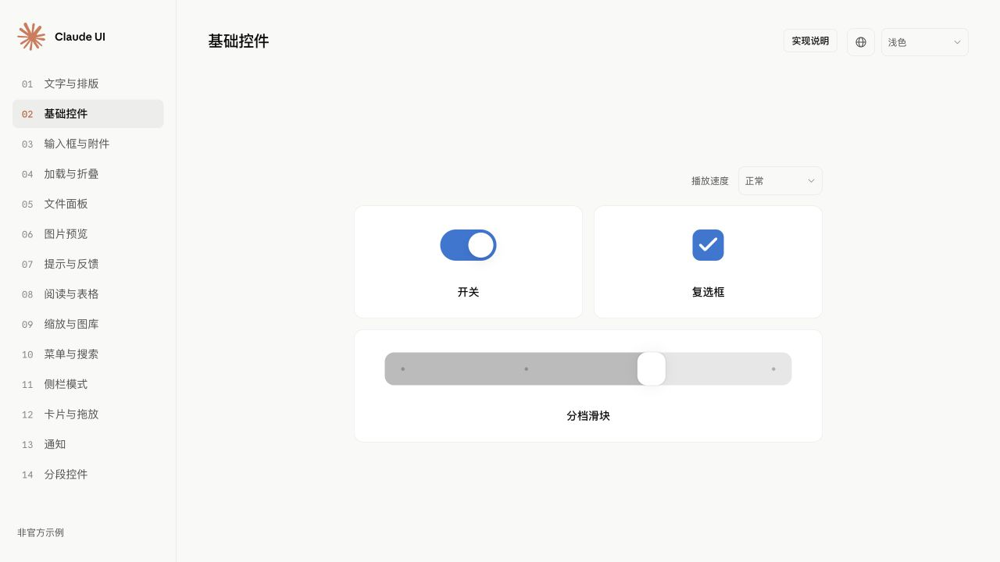

<h1 align="center">Claude UI Skills</h1>

<p align="center">
  <a href="LICENSE"></a>
  <a href="https://wcqqq1214.github.io/claude-ui-skills/"></a>
</p>

<p align="center">用于实现 Claude 风格 UI 和动效的 Agent Skill，附可直接导入的 React + Tailwind CSS 组件与交互演示。</p>

<p align="center">
  <a href="https://wcqqq1214.github.io/claude-ui-skills/">在线演示</a> &nbsp;
  <a href="#react-组件">React 组件</a> &nbsp;
  <a href="references/components.md">组件指南</a> &nbsp;
  <a href="README.md">English</a>
</p>

<p align="center">
  <picture>
    <source media="(prefers-color-scheme: dark)" srcset="docs/assets/demo-preview-zh-dark.jpg">
    
  </picture>
</p>

## React 组件

源码和 demo 均采用 **TSX + React 19 + Tailwind CSS 4**。全部 13 个 demo 章节从 [`src/index.ts`](src/index.ts) 导入同一套公开组件；示例数据、翻译和重播控制留在 `demo/` 中。

将完整的 `src/` 目录复制到使用 React 19、匹配的 React DOM 和 TypeScript，并已配置 Tailwind CSS 4 的项目，保留内部路径和资源。TypeScript 项目需使用 React 19 类型定义。在应用中导入一次组件样式：

```tsx
import { Switch } from './src';
import './src/styles/index.css';

export function Example() {
  return (
    <div data-cui-theme="light">
      <Switch aria-label="通知" defaultChecked />
    </div>
  );
}
```

组件提供类型化 props 和局部深浅主题，无需 demo 代码、后端或应用全局变量。样式入口不包含 Preflight，不会重置宿主页面；内置文字字体按需导入。

如果应用已经导入 Tailwind，请用 `src/styles/components.css` 替代 `src/styles/index.css`，参见[已有项目接入示例](examples/tailwind-host/README.md)。

本仓库提供可导入的源码，尚未发布为 npm 包。Tailwind 配置、资源处理、自定义字体及 API 请见[接入说明](demo/README.md#import-the-source)，各场景用法见[组件指南](references/components.md)。[迁移记录](docs/react-migration.md)说明了实现和兼容性验证。

## 安装为 Agent Skill

将完整仓库克隆到尚不存在的 Agent Skill 目录（Codex 或 Claude Code）。`SKILL.md` 应直接位于 Skill 文件夹根目录，并保留配套目录：指南直接链接其中的源码、样式、资源和文档。读取和使用 Skill 指南无需执行 `npm ci`；运行演示、构建或测试时才需要安装依赖。

```sh
# Codex
mkdir -p "${CODEX_HOME:-$HOME/.codex}/skills"
git clone https://github.com/wcqqq1214/claude-ui-skills.git \
  "${CODEX_HOME:-$HOME/.codex}/skills/claude-ui-skills"

# Claude Code
mkdir -p ~/.claude/skills
git clone https://github.com/wcqqq1214/claude-ui-skills.git \
  ~/.claude/skills/claude-ui-skills
```

在下一轮对话中明确调用已安装的 Skill（Codex 中如下；Claude Code 中请让它使用 `claude-ui-skills` Skill）：

```text
用 $claude-ui-skills 改进这个页面的侧栏与分段控件。
```

如果技能列表中没有出现它，检查目标目录是否直接包含 `SKILL.md`，而非再嵌套一层仓库文件夹。安装位置应属于运行当前任务的 Codex 环境；放在其他位置的项目副本不会自动成为已安装技能。也可以直接让 Agent 读取该副本的 `SKILL.md` 并按其说明操作。

Skill 覆盖 UI、前端交互、排版与动效，详见[范围与覆盖](docs/coverage.md)。

## 演示

**[在线体验 →](https://wcqqq1214.github.io/claude-ui-skills/)**

包含 13 个交互章节：文字与排版、基础控件、输入框与附件、加载与折叠、文件面板、图片预览、提示与反馈、阅读与表格、缩放与图库、菜单与搜索、侧栏模式、卡片与拖放、通知。分段控件合并展示在基础控件中。支持简体中文、English 和深浅主题。

实现说明默认收起，可按需展开。乌龟按钮默认以 0.2× 播放开关、复选框和滑块的动效，点击可恢复原速。主题可选择浅色、深色或跟随系统。

使用 Node.js 22.12+（或 20.x 系列的 20.19+），在仓库根目录执行：

```sh
npm ci
npm run dev
```

打开 Vite 输出的地址。通过 `?lang=zh-Hans` 或 `?lang=en` 指定语言，通过 `#controls` 打开上图的基础控件章节。截图来自当前 React demo，视口为 1280 × 720。

```sh
npm run build      # 类型检查并构建静态站点到 dist/
npm run preview    # 本地预览生产构建
```

生产构建包含本地资源，无需后端或安装 Claude。静态托管时使用 `dist/`，源码 HTML 需要通过 Vite 运行。在线演示由 Pages 工作流手动部署；fork 后需设置 `PAGES_ENABLED=true`，在 Settings → Pages 中选择 GitHub Actions，再手动触发工作流。入口和部署细节见[演示文档](demo/README.md#run)。

## 验证

```sh
npm test
```

依次执行单元测试、类型检查、生产构建和浏览器回归测试，覆盖独立导入、SSR hydration、StrictMode 与 Activity 保留 DOM 重连等场景。浏览器测试需要 Chrome/Chromium；安装位置不在默认目录时可设置 `CHROME_BIN`。详见[测试覆盖](tests/README.md)。

## 许可证

项目原创代码与文档采用 [MIT](LICENSE)。第三方字体、图标和 Logo 保留各自权利。

非官方项目，与 Anthropic 无关联。
